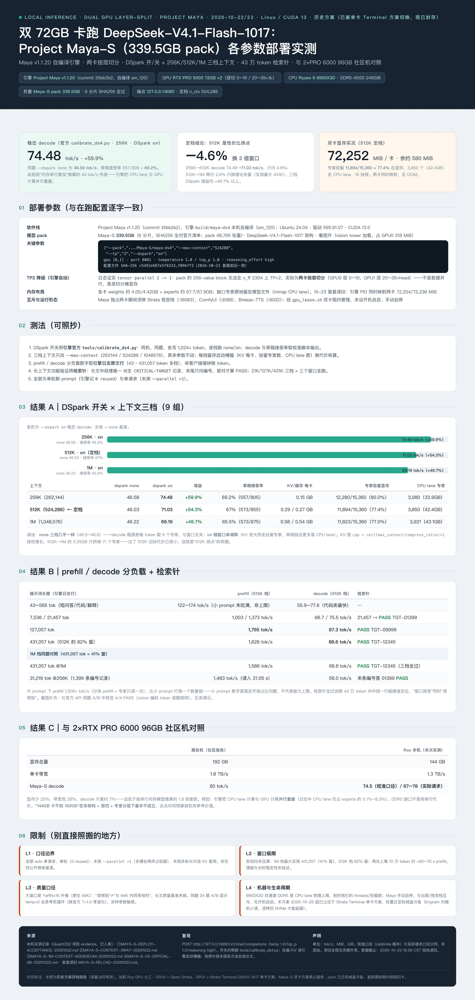

# DeepSeek-V4.1-Flash-1017 Maya-S on 2× RTX PRO 5000 72GB — full parameter sweep (DSpark × 256K/512K/1M)

Community benchmark report — Project Maya v1.1.20 (self-built sm_120), archived dual-GPU deployment. This entry consolidates the complete 9-cell DSpark on/off × context-window matrix plus load-type prefill/decode figures and a cross-hardware comparison. The quality-focused local-vs-official-API poster lives in the sibling [2026-10-23 entry](../2026-10-23-community-rtx-pro-5000-72gb-dsv41-maya-s/README.md); this one is the parameter/performance archive.



*The poster image is in Chinese; this README is the English source of record. Editable poster source: [poster-source.html](./poster-source.html), full-resolution PNG: [poster-zh.png](./poster-zh.png).*

> **Status note:** archived deployment. Measured 2026-10-22/23 on the then-active dual-GPU Maya service; superseded operationally by the single-GPU Strata Terminal entry dated 2026-10-25.

## Headline results

| Test | Result | Scope / caveat |
|---|---:|---|
| DSpark decode, 256K | **74.48 tok/s** (off: 46.58) | official `calibrate_ds4.py`, 1024+ tokens; +59.9%, draft acceptance 69.2% |
| DSpark decode, 512K (settled config) | **71.03 tok/s** (off: 46.03) | same harness; +54.3%, acceptance 67% |
| DSpark decode, 1M | **69.19 tok/s** (off: 46.22) | same harness; +49.7%, acceptance 65.5% |
| Peak prefill | **1,755 tok/s** @127K prompt | engine-log lines; 431K prompt still 1,626 tok/s |
| Retrieval needles | PASS at 21K / 127K / 431K tokens across all three windows | synthetic mid-document unique-ID probes |

## Setup (verbatim with the running configuration)

```
["--pack",".../Maya-S/maya-ds4","--max-context","524288","--tp","2","--dspark","on"]
gpu [0,1] · port 8081 · temperature 1.0 / top_p 1.0 · reasoning_effort high · images on
```

- 2× NVIDIA RTX PRO 5000 72GB (Blackwell), Ryzen 9 9950X3D, 249 GiB DDR5-6000 dual-channel, Ubuntu 24.04, driver 595.91.07, CUDA 13.0
- Project Maya v1.1.20 (commit `35bb2b2`), engine `build/maya-ds4` self-compiled for sm_120
- Maya-S pack **339.5 GB** (6 shards, all SHA-256 verified against the official manifest; 48,795 tensors), DeepSeek-V4.1-Flash-1017 architecture
- Config SHA-256 `c5d92e687e5f8333…` (identical before/after the 2026-10-23 reload)
- **TP2 falls back automatically**: engine log states `tensor parallel 2 -> 1` (256-value expert blocks can't split n_ff 2304 otherwise) — the real layout is a **layer split** (GPU0 layers 0–19, GPU1 layers 20–39 + head), not tensor parallelism
- VRAM banner @512K: per-card weights ~4.05/4.42 GB + experts ~67.7/67.9 GB; expert residency 11,894/15,360 (77.4%), 3,850 experts (42.4 GB) on the CPU lane, 16 threads; ~580 MiB free per card

## Method (M1–M5)

1. **M1** DSpark on/off via the engine's official `tools/calibrate_ds4.py`: same host, same task, 1,024+ generated tokens each.
2. **M2** Context sweep changes only `--max-context` (262,144 / 524,288 / 1,048,576); every boot banner (KV per card, resident experts, CPU-lane experts) captured for the cost accounting.
3. **M3** Prefill/decode per load taken from **engine-log lines** (43 – 431,057 prompt tokens), not client wall-time.
4. **M4** Long-context functional gate: unique `CRITICAL-TARGET` record buried mid-document; ask only its ID; exact match = PASS. Run at 21,457 / 127,057 / 431,057 tokens on all three windows.
5. **M5** All numbers are single-turn (`0 reused`) and single-request (`--parallel` not exercised).

## Results

### DSpark × context matrix (calibrate harness)

| Context | dspark none | dspark on | gain | draft acceptance | KV per card | expert residency | CPU-lane experts |
|---|---:|---:|---:|---:|---:|---:|---:|
| 256K | 46.58 | **74.48** | +59.9% | 69.2% (557/805) | 0.15 GB | 12,280/15,360 (80.0%) | 3,080 (33.9 GB) |
| 512K ← settled | 46.03 | **71.03** | +54.3% | 67% (573/855) | 0.29 / 0.27 GB | 11,894/15,360 (77.4%) | 3,850 (42.4 GB) |
| 1M | 46.22 | **69.19** | +49.7% | 65.5% (573/875) | 0.58 / 0.54 GB | 11,823/15,360 (77.0%) | 3,921 (43.1 GB) |

Reading: with DSpark off the three windows are identical (46.0–46.6) — decode is bound by fetching 6 experts per token, independent of window size. With DSpark on, throughput falls monotonically with window because KV growth evicts resident experts (KV `cap = ceil(max_context/compress_ratio)+1`, `ds4_model.cu:2193`) and draft verification hits the CPU lane more. 512K→1M costs only 71 extra evicted experts: **512K is the knee** — 256K→512K pays 4.6% decode for 2× window; beyond that you pay 2.6% for headroom never exercised (longest test 431K).

### Prefill / decode by load (engine log)

| Prompt | prefill (512K) | decode (512K) | needle |
|---|---:|---:|---|
| 43–565 tok | 122–174 tok/s (fixed overhead dominates; not a ceiling) | 55.9–77.6 (code fastest) | — |
| 7,536 / 21,457 tok | 1,003 / 1,373 tok/s | 66.7 / 75.5 tok/s | 21,457 → PASS TGT-01399 |
| 127,057 tok | **1,755 tok/s** | **87.3 tok/s** | PASS TGT-09999 |
| 431,057 tok (82% of 512K) | 1,626 tok/s | **88.6 tok/s** | PASS TGT-12345 |
| 431,057 tok @1M (41% window) | 1,586 tok/s | 68.8 tok/s | PASS TGT-12345 |
| 31,219 tok @256K | 1,483 tok/s (read-in 21.05 s) | 56.0 tok/s | last-record ID answered correctly |

Large prompts prefill 1,500+ tok/s (chunked prefill + experts read once); small-prompt rows are overhead-dominated and underestimate capability.

### Cross-hardware comparison

| | friend's host | this host (Roy) |
|---|---:|---:|
| VRAM total | 192 GB (2× PRO 6000 96GB) | 144 GB (2× PRO 5000 72GB) |
| Per-GPU bandwidth | 1.8 TB/s | 1.3 TB/s |
| Maya-S decode | 80 tok/s | **74.5 calibrated / 67–78 real requests** |

25% less VRAM and 28% less bandwidth cost only ~7%. Cause: the engine **overlaps CPU-lane work with GPU compute** (engine log: CPU lane handles only 0.1%–8.3% of experts per step), so the DDR5 shortfall is not a serial per-token penalty. A naive serial-memory model predicted a 1.8× gap and was wrong — retracted in the source report.

## Limitations (L1–L4)

- **L1** Solo, single-turn (`0 reused`); no `--parallel >1` (multi-slot would evict more experts), no multi-turn KV-reuse test; not a public leaderboard benchmark.
- **L2** Windows never saturated: 1M tested to 431,057 (41%), 512K to 82%; each extra 100K tokens ≈ +60–70 s prefill untested at the extreme.
- **L3** Large windows are YaRN×16 extrapolation (native 64K): "retrievable" ≠ "as sharp as within 64K" — long-doc quality baselines not run. `temperature=0` can loop on thinking (official T=1.0 showed zero degradation across 24 calls).
- **L4** Host-specific: 9950X3D dual-channel DDR5 bounds the CPU lane — calibrate on your own machine instead of copying thread/residency numbers. Lifecycle: manual start/stop under a GPU lease, mutually exclusive with the image/vision stack, no autostart; pack later migrated to HDD cold storage (Engram needs NVMe for random small reads).

## Raw data

`raw/` holds the calibration logs (all three windows), retrieval-probe logs, live-boot logs, and a 400-line engine-log excerpt with the banner and `read in` / `generated in` lines the tables above are computed from.

## Acknowledgements

Thanks to the Project Maya authors for the CPU-offload engine and calibration harness, and to the community 2× PRO 6000 report that gave us a real cross-hardware anchor.
