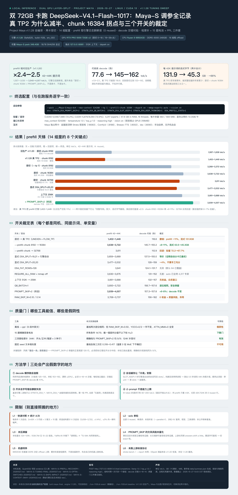

# Maya-S (DeepSeek-V4.1-Flash-1017) on 2x RTX PRO 5000 72GB — engine v1.1.28 tuning sweep

Community benchmark report — Project Maya v1.1.28 (self-built for sm_120), measured 2026-10-27.
This entry records the configuration campaign that followed the 2026-10-22/23 DSpark x context sweep:
true TP2 vs layer split, prefill chunk size, explicit layer split, strict-RAM mode, context downsizing,
and the three opt-in switches (`Q8_BATCH`, `PROMPT_SKIP`, `RAM_SKIP_W`). It is the configuration
currently serving on the host (`maya-final`, engine 1.1.28, 512K context).



*The poster is in Chinese; this README is the English source of record. Editable poster source:
[poster-source.html](./poster-source.html), PNG preview (1,560 px): [poster-zh.png](./poster-zh.png),
headline chart: [chart-prefill.jpg](./chart-prefill.jpg).*

## Headline results

| Change | prefill @42–44K (tok/s) | decode, code (warm) | Verdict |
|---|---:|---:|---|
| Baseline: v1.1.20, layer split, chunk 8192 | 1,587–1,638 | 77.6 | old production |
| v1.1.28, **true TP2**, chunk 8192 | 1,402–1,449 | 118.6 | prefill **-11%** — dropped |
| v1.1.28, **layer split** (`--tp 1`), chunk 8192 | 3,268–3,372 | 133.7–142.2 | prefill **x2.3** vs TP2 |
| + `--prefill-chunk 16384` | 3,638–3,722 | 145.7–155.2 | **settled baseline** |
| + `--prefill-chunk 32768` | 3,611 | 112.9 | regression (activations evict residency) |
| + `STRATA_DS4_PROMPT_SKIP=2` | **3,939–4,007** | 157.3–157.8 | **+6–8%**, decode unchanged, recall intact |
| + `RAM_SKIP_W=0.10 / 0.14` | 3,708–3,737 | 156–162 | no gain — rejected |
| Context 512K → 256K | 3,661–3,688 | 132–157 | no gain; wastes window |
| Explicit `DS4_SPLIT=20,20` | 3,477–3,532 | 128–159 | **-4%** vs the engine's automatic 19/21 |
| `REQUIRE_ALL_RAM=1` (+ `mmap off`) | 3,630–3,675 | 131–152 | no change; `auto` already copies all experts |

Against the previous v1.1.20 production configuration the settled build delivers **prefill x2.4–2.5**
(1,587–1,638 → 3,940–4,007 tok/s at 42–44K prompts) and **code-class decode x1.9–2.1** (77.6 → 145–162 tok/s),
while the streamed weight traffic per 42K prompt fell from 131.9 GB (TP2) to 45.3 GB (layer split + chunk 16384).
Follow-up prompts on the same 44K context re-read 0.3 s (`44,356/44,357 reused`) instead of the full prompt.

## Setup (verbatim with the running configuration)

```
--pack .../Maya-S/maya-ds4 --max-context 524288 --tp 1 --prefill-chunk 16384
--dspark on --mmap-experts auto --vision on
env: STRATA_DS4_PROMPT_SKIP=2  STRATA_DS4_Q8_BATCH=1  STRATA_DS4_SLOT_KEEP=1
     STRATA_DS4_KEEP_THINKING=1  DS4_PREFILL_STATS=1
```

- 2x NVIDIA RTX PRO 5000 72GB (Blackwell), 73,415 MiB each; driver 595.91.07; AMD Ryzen 9 9950X3D; 249 GiB DDR5-6000 (dual-channel)
- Ubuntu 24.04, CUDA 13.0
- Project Maya v1.1.28 (commit 6afa525), build-1128/maya-ds4, sm_120
- Maya-S pack 348.4 GB, 25 files, 18/18 SHA-256 checks passed; mixed IQ2_XXS/IQ2_S/IQ3_S, 2.56 bpw, DeepSeek-V4.1-Flash-1017 architecture
- VRAM banner (512K): CUDA0 5,548/7,680 (72.2%), CUDA1 5,879/8,064 (72.9%); 4,317 experts / 47.6 GB in RAM, 16 threads; 583/584 MiB free per card
- Vision tower runs in the engine on GPU0 (318 MiB), up to 1,024 tokens per image
- API `http://127.0.0.1:8081/v1` (OpenAI + Anthropic), browser UI on `/`, `/health` reports version 1.1.28 and
  `max_context` 524288

## Method (M1–M6)

1. **M1 — structure first.** Every round changed exactly one structural knob (TP mode, prefill chunk,
   explicit split, context window); the opt-in switches were stacked afterwards on the settled structure.
2. **M2 — engine-log timing only.** prefill/decode numbers are the engine's own
   `prompt N tokens = ... read in X ms (P tok/s), M generated in Y ms (D tok/s)` lines.
   Client wall-clock divided by completion tokens is not used (it folds prefill and queueing into decode).
3. **M3 — fresh reads.** Only lines with `0 reused` count as prefill measurements; `reused` hits are cache reuse.
4. **M4 — cold/warm split.** The first request after a restart is cold (disk/page cache); decode tables use
   warm values and the cold value is reported separately when it differs materially.
5. **M5 — interleaved decode A/B.** Decode comparisons were run A → B → A with a fresh boot per round,
   stopping every Maya unit before clearing the pack's `slots/` folder (reversing that order pollutes the
   next "cold" read with a stale session write-back). Sequential runs drift by up to 20% and fake a win.
6. **M6 — quality gates.** 15-question exactness battery, three-depth retrieval needles (front/mid/tail in a
   44,480-token prompt, formula-verifiable answers), plus offline `--ppl` where it is valid.

## Results

| Configuration | prefill 42–44K (tok/s) | prefill 124–131K | decode code (warm) | decode prose | expert residency | streamed bytes per 42K prompt | Verdict |
|---|---:|---:|---:|---:|---:|---:|---|
| **R0** v1.1.20 layer split, chunk 8192 (old production) | 1,587-1,638 | 1,626 | 77.6 | 55.9-77.6 | 77.4% | - GB | baseline |
| **R1** v1.1.28 true TP2, chunk 8192 | 1,402-1,449 | - | 118.6 | 73.4 | 71.1 / 71.4% | 131.9 GB | dropped: prefill -11% |
| **R2** v1.1.28 layer split (--tp 1), chunk 8192 | 3,268-3,372 | - | 133.7-142.2 | 56.9 | 74.5 / 74.9% | 63.5 GB | prefill x2.3 vs TP2 |
| **R3** v1.1.28 layer split, chunk 16384 | 3,638-3,722 | 3,650 | 145.7-155.2 | 66.0-66.8 | 72.2 / 72.9% | 45.3 GB | settled baseline |
| **R4** + chunk 32768 | 3,611 | - | 112.9 | - | 67.7 / 68.9% | 41.2 GB | regression: activations evict residency |
| **R5** + DS4_FAT_ROWS=128 | 3,641 | - | 124.1-131.7 | - | 72.2 / 72.9% | 45.3 GB | no effect (default 64 already covers) |
| **R6** explicit DS4_SPLIT=19,21 | 3,659-3,689 | - | 137.5-155.0 | - | - | 43.8 GB | identical to engine auto split |
| **R7** explicit DS4_SPLIT=20,20 (even by layer count) | 3,477-3,532 | - | 128.4-159.2 | - | - | 48.1 GB | -4%: even split is worse |
| **R8** --mmap-experts off + DS4_REQUIRE_ALL_RAM=1 | 3,630-3,675 | - | 131.3-152.3 | - | - | 43.9 GB | no change: auto already copies all 4,317 experts |
| **R9** --max-context 262144 (512K→256K) | 3,661-3,688 | - | 132.4-157.4 | - | - | 43.3 GB | no change: KV saves only 0.14 GB per card |

*Residency is per GPU (CUDA0 / CUDA1). `-` = not measured in that round. Streamed bytes are the
`DS4_PREFILL` engine counters summed over both GPUs for the same 42–44K prompt family.*

### Opt-in switches (stacked on R3)

| Condition (stacked on R3: layer split + chunk 16384) | prefill 42–44K | prefill 124–131K | decode code | decode prose | Quality gate | Verdict |
|---|---:|---:|---:|---:|---|---|
| **R10** + STRATA_DS4_Q8_BATCH=1 | 3,693-3,722 | - | 156.7-157.6 | 70.2-70.6 | 14/15 · needle PASS | bit-identical, no measurable effect, kept |
| **R11** + STRATA_DS4_PROMPT_SKIP=2 (settled) | 3,939-4,007 | 3,708 | 157.3-157.8 | 68.7-71.1 | 14/15 · 9/9 needle @44K · 124K needle PASS | +6-8% @42K, decode unchanged, recall intact |
| **R12** + STRATA_DS4_RAM_SKIP_W=0.10 | 3,708-3,737 | - | 156.2-157.8 | 69.7-71.4 | 14/15 · 42K needle PASS | no gain, rejected |
| **R13** + STRATA_DS4_RAM_SKIP_W=0.14 | 3,722-3,724 | - | 158.1-162.2 | 71.1-72.8 | 14/15 · 42K needle PASS | no gain (within drift), rejected |


### DSpark reference (v1.1.20 calibration, 2026-10-22)

| Context | `--dspark none` | `--dspark on` | Gain | Draft acceptance |
|---|---:|---:|---:|---:|
| 256K | 46.58 | **74.48** | +59.9% | 69.2% |
| 512K | 46.03 | **71.03** | +54.3% | 67% |
| 1M | 46.22 | **69.19** | +49.7% | 65.5% |

With DSpark off the three windows are identical (46.0–46.6 tok/s) — decode is bound by fetching
6 experts per token, not by window size. These numbers were **not re-calibrated on v1.1.28**; every
v1.1.28 round quoted above ran with `--dspark on`. Treat the gain as carried over, not re-measured.

## Why the knobs behave this way

1. **True TP2 is a way to add cards, not to split two.** With a fixed 144 GB, TP2 cuts every expert in half
   across two GPUs, so the number of *complete* specialists that fit drops (residency 71.1/71.4% vs 74.5/74.9%)
   while per-42K-prompt streaming doubles (131.9 vs 63.5 GB). The upstream 1.9x prompt figure was measured on
   **nine** GPUs with `--tp 8`; the gain comes from extra capacity, not finer splitting.
2. **Layer split leaves the pipeline at 19/21 because the engine solves it.** For `chunk>0 && groups>1`
   `ds4_model.cu` runs a DP that minimises the busiest card's streamed bytes; it lands on layers 0–18 / 19–39+head.
   Forcing 20/20 replaces an optimum with a worse feasible point (-4%).
3. **Chunk 16384 halves the number of chunks**, so hot experts are re-fetched fewer times: GPU0's streamed
   bytes for a 42K prompt fell 52.1 → 33.6 GB and prefill rose +8–11% across the two same-pair comparisons. Chunk 32768 keeps lowering traffic (28.7 GB)
   but its activations evict resident experts (72.2% → 67.7%), which cancels the gain. 16384 is the knee.
4. **A smaller window does not buy experts here.** DeepSeek V4.1 stores KV in a compressed form (FP4 + sliding
   window): 512K → 256K frees only 0.14 GB per card, i.e. ~36 extra experts (+0.3%). Textbook "halve the context
   to free VRAM" does not transfer to this model.
5. **`REQUIRE_ALL_RAM` is already implied by `auto`.** `--mmap-experts auto` copies all 4,317 CPU-lane experts
   (47.6 GB) into RAM at boot; the strict flag only turns that into a hard requirement and refuses to start
   unless `--mmap-experts off` is also set.
6. **`PROMPT_SKIP=2` is the one switch with real upside and a real trade.** It keeps the full-precision path for
   the first 2,668 rows (default) vs. only 128 rows for layers 20–39, which is DeepSeek's own online-serving
   approach ("SWA bounded replay"). It never changes decode, and factual retrieval is unchanged in our probes,
   but upstream says answers "shift a little": fine for reading long documents, not for byte-reproducible writing.
7. **`RAM_SKIP_W` targets a different shape.** The upstream 20–43% gain was measured on Maya-XS with *all* experts
   on the CPU lane; at 72% residency the skipped experts are the ones that would have been read anyway, so the
   measured gain is zero and the quality risk is paid for nothing.

## Quality gates: only two of the three tools are usable

| Tool | Result on this campaign | Verdict |
|---|---|---|
| `--ppl FILE` | Baseline run twice was bit-identical (4.0933 / 3.8300 / 3.7342 / 9.0713 / 7.0358 / 5.3583), but `RAM_SKIP_W=0.50` and `DS4_YOCO=0/2` did not move it at all while `DS4_ATTN_MMA=0` changed every value | **False negative** for "skip some work" switches; only valid for numerical-path changes |
| 15-question exactness battery | 14/15 on every condition; the single miss is the scorer rejecting the subscript `H2O` | Valid lower-bound gate, low sensitivity |
| Three-depth retrieval needles | 9/9 for both exact mode and `PROMPT_SKIP=2` on a 44,480-token prompt (front = record 40, mid = record 1,200, tail = record 2,395; 3 seeds; answers checked with `(i*13+seed) mod 9973`), plus the 124K needle | Valid; **asking only for the last record is a false pass** — the switch keeps exactly the tail rows |
| Fixed-seed text similarity | The baseline itself scored only 0.318–0.417 similarity across three runs at temperature 0 (MoE + batching is not deterministic) | **Unusable**; cross-condition similarity falls inside noise, so "the wording did not change" cannot be claimed |

## Limitations (L1–L6)

- **L1** Quick comparison, not a statistical A/B: one boot per condition, 2 x 42K prompts, 3 code prompts,
  3 prose prompts and the 15-question battery. The settled structure (R3) accumulated six independent boots
  (3,638–3,722, ±1.4%), so differences inside ±3% are treated as noise.
- **L2** Solo, single-turn (`0 reused`); no `--parallel >1`, no multi-turn KV-reuse test, no vision or
  tool-call workload; not a public leaderboard benchmark.
- **L3** Window never saturated: the longest prompt here is 124–131K; the 512K/1M behaviour is covered by the
  sibling 2026-10-22 entry, and YaRN x16 extrapolation means "retrievable" is not "as sharp as within 64K".
- **L4** `PROMPT_SKIP=2` style drift is not quantified. Factual recall and short-answer accuracy are unchanged
  in our gates; long-form wording reproducibility is untested and upstream documents a small shift.
- **L5** Host-specific: a 9950X3D with dual-channel DDR5-6000 and 16 CPU-lane threads bounds the offload path.
  Copy the ordering of the knobs, not the residency numbers; run `--speed-calibration` on your own box.
- **L6** The upstream `strata bench` / `--report` standard protocol was not run. DSpark gains were calibrated
  on v1.1.20, not re-measured on v1.1.28.

## Raw data

`raw/` holds the per-round engine logs (`maya-ds4-opt.log` = true TP2, `-layersplit`, `-chunk16k`, `-chunk32k`,
`-fatrows`, `maya-t1/t1b/t2/t4/t5/t6`, `maya-q0-q8batch`, `maya-q1-skip2`, `maya-q2-ramw`, `maya-q2b-ramw14`,
`maya-ds4-prod.log`), the offline `ppl-*.log` files, and `maya-ds4-final-excerpt.txt` — a content-free excerpt of
the running service's engine lines (boot banner, residency, 42K timing). `data/summary.json` is the machine-readable
table every figure above is generated from; `data/build_tables.py` regenerates it.

## Acknowledgements

Thanks to the Project Maya authors for the CPU-offload engine and the calibration harness, and to the community
2x RTX PRO 6000 report that provided the cross-hardware anchor used in the 2026-10-22 entry.
